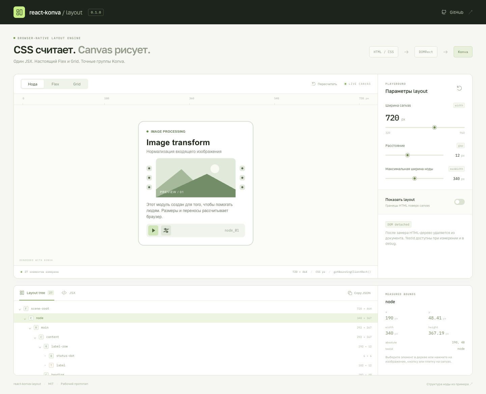

# react-konva-layout

Рабочий прототип раскладки для React Konva: браузер рассчитывает Flex и Grid в HTML, библиотека измеряет элементы через `getBoundingClientRect()` и переносит координаты в группы Konva. Разметка описывается одним JSX-деревом.

## Запуск

```sh
npm install
npm run dev
```

Откройте адрес, который напечатает Vite. Для сборки:

```sh
npm run build
npm run preview
```

`build` проверяет TypeScript и создаёт:

- `dist/` — статическое демо;
- `dist-lib/react-konva-layout.js` — ESM-библиотеку;
- `dist-lib/*.d.ts` — объявления типов.

Имя пакета — `@dzenlotus/react-konva-layout`, но он пока не опубликован в npm. Внутри этого репозитория импортируйте компоненты из `./lib`. Для другого проекта можно подключить локальный каталог через `npm install /путь/к/react-konva-layout` или репозиторий через `npm install github:dzenlotus/react-konva-layout`. Скрипт `prepare` запускает сборку при установке; входная точка пакета находится в `dist-lib/`. После подключения импортируйте компоненты из `@dzenlotus/react-konva-layout`.

## Пример

```tsx
import { useRef, useState } from 'react';
import { Circle, Rect } from 'react-konva';
import { Box, Col, LayoutCanvas, LayoutText, Row } from './lib';
import type { LayoutCanvasHandle, LayoutNode } from './lib';

export function Example() {
  const canvas = useRef<LayoutCanvasHandle>(null);
  const [tree, setTree] = useState<LayoutNode[]>([]);

  return <>
    <button onClick={() => canvas.current?.remeasure()}>
      Пересчитать layout
    </button>
    <LayoutCanvas ref={canvas} width={600} height={300} onLayout={setTree}>
      <Row id="root" width="100%" height="100%" padding={24}
        gap={16} alignItems="center">
        <Box id="preview" data-testid="preview" width={120} height={100}
          render={({ width, height }) => <>
            <Rect width={width} height={height} fill="#dce8cf" cornerRadius={12} />
            <Circle x={width / 2} y={height / 2} radius={24} fill="#78985a" />
          </>} />
        <Col id="content" flexGrow={1} minWidth={0} gap={8}>
          <LayoutText id="title" text="Браузер считает размеры"
            fontFamily="Arial" fontSize={20} fontStyle="bold" />
          <LayoutText id="description" width="100%"
            text="Координаты и размеры поступают в Konva из HTML."
            fontFamily="Arial" fontSize={14} lineHeight={1.5} />
        </Col>
      </Row>
    </LayoutCanvas>
    <pre>{JSON.stringify(tree, null, 2)}</pre>
  </>;
}
```

`LayoutCanvas` уже создаёт `Stage` и `Layer`. Компоненты layout нужно размещать внутри него. `Box.render` получает измеренные `width` и `height`; внутри можно рисовать любые компоненты Konva с локальными координатами относительно этого `Box`.

## Компоненты и свойства

| Компонент | Назначение |
| --- | --- |
| `LayoutCanvas` | Размер canvas: `width`, `height`; отладка: `debug`; результат: `onLayout`; также `ref`, `style`, `className`. |
| `Flex` | CSS Flexbox; направление задаётся через `direction`. |
| `Row` | Flexbox с направлением `row`. |
| `Col` | Flexbox с направлением `column`. |
| `Grid` | CSS Grid, например `gridTemplateColumns="repeat(3, minmax(0, 1fr))"`. |
| `Box` | Контейнер или место для собственного рисунка через `render`. |
| `LayoutText` | Измеряемый HTML-текст, который затем рисуется через Konva Text. |

Общие свойства: `id`, `data-testid`, `children`, `style`, размеры (`width`, `height`, `minWidth`, `maxWidth`, `minHeight`, `maxHeight`), `padding`, `gap`, `rowGap`, `columnGap`, `alignItems`, `justifyContent`, `alignSelf`, `flexGrow`, `flexShrink`, `flexBasis`, `flexWrap`, `gridTemplateColumns`, `gridTemplateRows`. Числовые размеры задаются в CSS-пикселях; допустимы и CSS-значения вроде `"100%"`.

Для оформления Konva-контейнера используются `fill`, `stroke`, `strokeWidth`, `cornerRadius`. `onClick` задаёт обработчик нажатия. Дополнительные CSS-свойства раскладки можно передавать через `style`.

У `LayoutText` есть обязательный `text` и свойства `fontSize`, `fontFamily`, `fontStyle` (`"bold"`, `"italic"`, `"bold italic"`), `lineHeight`, `color`, `align`. `lineHeight` — множитель размера шрифта, например `1.5`.

## Дерево измерений

`onLayout(tree)` вызывается, когда меняются измеренные координаты, размеры или структура дерева. Каждый `LayoutNode` содержит:

```ts
{
  id: string;
  type: 'flex' | 'row' | 'col' | 'grid' | 'box' | 'text';
  x: number;          // относительно родительского layout-элемента
  y: number;
  width: number;
  height: number;
  absoluteX: number;  // относительно LayoutCanvas
  absoluteY: number;
  testId?: string;
  children: LayoutNode[];
}
```

Задавайте явные `id`, если результат нужен для поиска элементов или внешних связей. Без `id` используется идентификатор React.

## Жизненный цикл HTML-слоя

Первое измерение выполняется после монтирования. На время расчёта HTML-дерево добавляется в документ с `opacity: 0`. После измерения весь контейнер раскладки удаляется из документа; Konva продолжает рисовать по сохранённому дереву координат.

В состоянии `idle` HTML-узлов раскладки и их `data-testid` в документе нет. Компоненты React сохраняют состояние: их DOM-поддерево хранится в отсоединённом контейнере portal. При изменении JSX и свойств, размера окна или загрузке шрифтов тот же контейнер временно добавляется для нового измерения и снова удаляется. Актуальные размеры доступны через `onLayout`; для внешних изменений CSS можно вызвать `ref.current?.remeasure()`.

`debug={true}` оставляет HTML-дерево в документе и показывает его границы и подписи поверх canvas. В этом режиме элементы доступны через `data-testid`. Состояние можно посмотреть на контейнере canvas в DevTools по атрибуту `data-layout-state`: `measuring`, `idle` или `debug`.

## Что посмотреть в демо

Скриншоты: [нода](docs/screenshots/node.png), [layout-слой](docs/screenshots/layout-overlay.png), [Grid](docs/screenshots/grid.png).



1. В примере «Нода» измените ширину canvas, расстояние `gap` и максимальную ширину ноды: изображение и описание перестраиваются вместе с портами.
2. В «Flex» переключите направление, выравнивание и число элементов. В «Grid» измените число колонок.
3. Включите «Показать layout», чтобы сопоставить HTML-границы с рисунком Konva. После выключения проверьте в DevTools, что `document.querySelector('.konva-layout-measure')` возвращает `null`.
4. Выберите элемент в дереве или нажмите на изображение, кнопку либо плитку на canvas. Справа появятся его координаты, размеры и `testid`.
5. Скопируйте JSON дерева или JSX примера через кнопку над результатом.

Структура ноды взята из [исходного примера CodeSandbox](https://codesandbox.io/p/sandbox/reverent-darwin-sdgd8h?file=/src/App.js): `label`, `title`, `subTitle`, входные порты, изображение, выходные порты, `description` и `actionPanel`. Графика и интерфейс демо реализованы здесь отдельно.

## Стресс-сцена

Откройте `/?stress=1`, чтобы запустить сцену с 1000 сложных нод. Для замеров используйте `npm run build` и `npm run preview`: режим разработки добавляет собственные накладные расходы.

На Apple M5 в production-сборке: первый монтаж **588,8 мс**, медиана пяти повторных монтажей **490,9 мс**, resize **482,6–518 мс**. Сцена содержит 51 001 объект Konva. [Методика и все результаты](docs/performance.md) · [скриншот сцены](docs/screenshots/stress-1000.png).

## Ограничения прототипа

- Нужен браузер с DOM, `ResizeObserver` и CSS Font Loading API; серверный расчёт layout не поддерживается.
- CSS определяет раскладку, но произвольное CSS-оформление не переводится в canvas. Тени, фоновые изображения, псевдоэлементы и другие визуальные эффекты нужно рисовать в Konva самостоятельно.
- Текст измеряют HTML и Konva разными механизмами: для сложной типографики проверяйте переносы визуально.
- Произвольные HTML-дети не становятся рисунком Konva автоматически. Используйте layout-компоненты и `Box.render`.
- Это прототип для проверки подхода, без автоматических тестов.

Лицензия: MIT.
