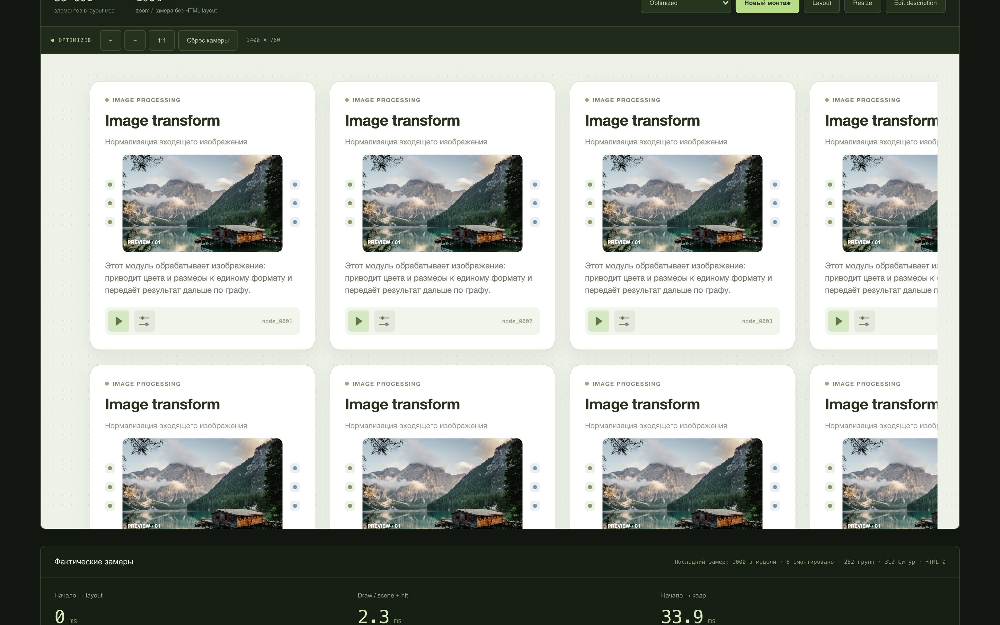
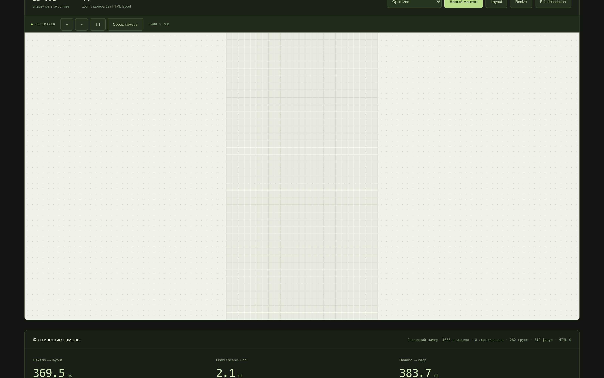

# 1000 оформленных нод: рендер и движение камеры

Замеры от 17 октября 2026 года. Сцена использует тот же [ReferenceNode](../src/examples/ReferenceCard.tsx), что и основной пример: текст, фотографию, шесть портов, две кнопки, тень и редактируемое описание. Все результаты и интервалы кадров сохранены в [designed-stress-results.json](designed-stress-results.json).

Без замедления CPU сцена держала **60,0 FPS** при pan и zoom. При CPU ×4 zoom снизился до **52,8 FPS**; при ×6 — до **33,9 FPS**, pan — до **48,6 FPS**. Обзорная LOD-траектория осталась около 60 FPS во всех трёх профилях.

## Монтаж сцены

Время в ms: медиана трёх монтажей и диапазон в скобках.

| CPU |        Начало → layout |          Начало → кадр | Draw scene + hit |
| --- | ---------------------: | ---------------------: | ---------------: |
| ×1  |    333,7 (324,8–426,1) |    351,4 (350,2–456,4) |    3,4 (3,0–3,4) |
| ×4  | 1379,6 (1346,4–1538,6) | 1451,0 (1404,0–1609,9) |   9,6 (9,3–10,0) |
| ×6  | 2125,5 (2060,4–2170,5) | 2219,8 (2139,2–2259,7) | 12,9 (11,9–15,8) |

## FPS камеры

FPS — медиана трёх прогонов pan/zoom; для overview выполнен один прогон. P95, максимальный интервал и доля задержек рассчитаны по исходным интервалам кадров.

| CPU | Траектория     | FPS с завершённым draw | P95, ms | Интервалы >20 ms | Максимум, ms |
| --- | -------------- | ---------------------: | ------: | ---------------: | -----------: |
| ×1  | pan            |                   60,0 |    16,8 |             0,0% |         16,8 |
| ×1  | zoom           |                   60,0 |    16,7 |             0,0% |         16,8 |
| ×1  | overview / LOD |                   60,0 |    16,7 |             0,0% |         16,8 |
| ×4  | pan            |                   60,0 |    16,8 |             0,2% |        100,0 |
| ×4  | zoom           |                   52,8 |    33,3 |            13,6% |         66,6 |
| ×4  | overview / LOD |                   60,0 |    16,8 |             0,0% |         16,8 |
| ×6  | pan            |                   48,6 |    33,4 |            18,1% |         66,7 |
| ×6  | zoom           |                   33,9 |    50,0 |            63,6% |        100,0 |
| ×6  | overview / LOD |                   60,0 |    16,7 |             0,0% |         16,8 |

Во всех 5654 измеренных интервалах завершился `Layer.draw()`; обычный RAF FPS совпал с FPS кадров с draw. Пустых интервалов не зарегистрировано. Медиана 60 FPS при CPU ×4 pan не исключает отдельной задержки до 100 ms; P95 и максимумы показывают такие случаи отдельно.

При движении камеры измерительный HTML оставался отсоединённым, число его элементов в документе — **0**, ревизия layout не менялась. Зарегистрированный пик растровых кешей — **15,47 MiB** при бюджете 32 MiB. При pan видимы 15–23 корня, при zoom — 12–28; обзорная траектория использует минимальный LOD для 550–825 видимых корней и не выделяет растровые кеши.

CPU ×6 не удерживает 60 FPS при подробном pan/zoom. Для такого режима нынешнюю реализацию нельзя считать плавной во всех сценариях; LOD существенно снижает нагрузку.

## Сцена и качество

В модели находятся 1000 нод шириной 360 px и 35 001 элемент Flex/Cell/CellText. Ноды расположены в 25 колонках в пространстве 9616 × 18176 px. Они используют один декодированный JPEG 640 × 420; это нагрузка с общим превью, а не загрузка 1000 разных фотографий.

Включены culling, кеш видимых нод, автоматическая плотность кеша, бюджет 32 MiB и LOD. В начальном viewport смонтированы восемь нод. Это проверка сцены с моделью из 1000 нод и работающими оптимизациями; все 1000 подробных карточек одновременно не рисуются.

Canvas сохраняет DPR 2 во всех прогонах. Плотность растровых кешей следует масштабу камеры; при нехватке бюджета карточка рисуется напрямую. Во время замера качество слоя не понижается.

Отдельная проверка после прогонов подтвердила плотность кешей 2 при масштабе 1 и 4 при масштабе 1,6; DPR слоя в обоих случаях оставался 2. Остальные видимые карточки при заполнении бюджета рисуются напрямую. У всех превью один общий объект изображения; измерительного HTML в документе нет.





## Локальное редактирование и вся сцена

После нового монтажа при CPU ×1 сохранение описания первой ноды вызвало одно локальное измерение: **35 элементов**, корень `stress-node-0000-card`. Измерение заняло **2,9 ms**, сохранение → кадр — **49,6 ms**, завершённый draw — **1,5 ms**. Ссылки на модель соседней ноды, её Konva-группу и bitmap кеша сохранились. Редактор удалён, измерительного HTML в документе — 0.

Команда «Все 1000 / LOD» при масштабе 0,04181338 показала все 1000 корней из модели: 1002 группы и **одна Shape** в минимальном LOD, без растровых кешей, при canvas DPR 2. Это упрощённый обзор; фотография и подробный текст появляются при приближении.

Эти проверки выполнены отдельно от FPS-матрицы; исходные снимки состояния сохранены в [designed-stress-checks.json](designed-stress-checks.json).

## Условия и методика

- Apple M5, 24 GiB RAM, macOS 26.2, Headless Chrome 155.
- Production-сборка Vite; viewport браузера 1600 × 1000, DPR 2; canvas 1400 × 760.
- Три режима CPU: без замедления, ×4 и ×6 через DevTools. GPU, RAM и compositor остаются теми же.
- В каждом режиме — три новых монтажа React-сцены, три pan-прогона, три zoom-прогона и один обзорный LOD-прогон. Это повторные монтажи в одной странице, а не три холодные навигации.
- JPEG декодирован и `document.fonts.ready` завершён до начала таймера монтажа. Первоначальная подготовка изображения заняла 10,4 ms; она записана отдельно в `assetReadyMs` и не включена в время рендера.
- Каждый монтаж строит новую модель и новые кеши. Геометрия повторяющихся карточек использует `layoutTemplate`: 999 попаданий и один промах; прочитаны границы 1035 элементов.
- Камера проходит одинаковую траекторию по времени: одна секунда прогрева и пять секунд измерения. Pan работает при масштабе 1; zoom меняет масштаб от 0,65 до 1,6 и пересекает уровни плотности кеша; обзорная траектория использует минимальный LOD при масштабе 0,06–0,10.

`Начало → layout` включает монтаж React и подготовку модели. `Начало → кадр` заканчивается после завершённого `Layer.draw()` и следующего RAF. `Draw` — время JavaScript-вызова, рисующего scene и hit canvas; оно не включает всё время подготовки карточек и кешей.

FPS в таблице считает RAF-интервалы, в которых завершился хотя бы один `Layer.draw()`. Дополнительно записаны обычный RAF FPS, число draw и пустых кадров. Это проверка работы JavaScript и canvas, а не измерение физического показа кадра GPU на экране. Замер прекращается при скрытии вкладки.

Для трёх повторов указана медиана FPS. P95 и доля интервалов дольше 20 ms рассчитаны по объединённым исходным `frameIntervalsMs`, а не усреднением процентилей. Метрики кеша, HTML и числа видимых корней снимаются каждые 250 ms: их максимумы являются зарегистрированными пиками, а не непрерывным измерением. `layoutPasses` камерного прогона — разница ревизий метрик раскладки.

## Что означает замедление CPU

CPU ×4/×6 показывает чувствительность сцены к более медленному основному потоку. Оно не заменяет проверку на физическом слабом компьютере: видеокарта, память, пропускная способность и браузер остаются от этой машины. Результаты нельзя обещать как FPS любого бюджетного ноутбука.

Исторические [замеры первого прототипа](performance-optimized.md) использовали другие карточки шириной 230 px и DPR1. Сравнивать их время напрямую с нынешними карточками шириной 360 px, фотографией, тенью и DPR2 некорректно.

## Повторить замер

```sh
npm install
npm run build
npm run preview
```

Открыть `http://localhost:4173/?stress=1`, выбрать Optimized и нажать «Новый монтаж». Затем доступны кнопки FPS pan, zoom и overview. Стресс-сцена наследует DPR устройства; дополнительный `retina=1` больше не требуется. Для сопоставления с этим отчётом нужны тот же размер canvas, DPR 2 и видимая вкладка.

Из консоли доступны те же операции:

```js
await layoutStress.run('optimized');
await layoutStress.camera('pan', 5000, 1000);
await layoutStress.camera('zoom', 5000, 1000);
await layoutStress.camera('overview', 5000, 1000);
layoutStress.stats();
```

CPU slowdown задаётся отдельно в DevTools. При автоматизации изменение CPU не должно сбрасывать эмуляцию viewport и DPR: проверяйте `window.devicePixelRatio` и `layoutStress.stats().canvasPixelRatio` перед каждым профилем.
