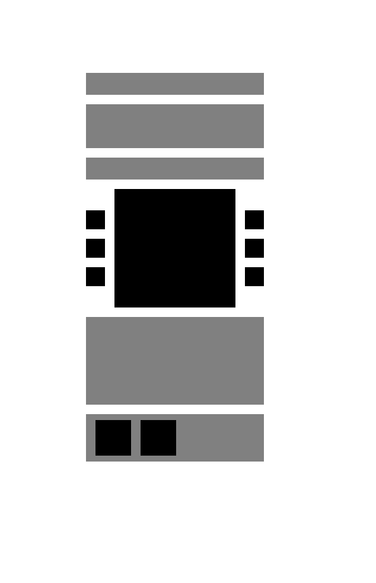

# Встраиваемый компонент

В версии 0.3 основной API — `Flex`, `Cell`, `CellText`. Корневой `Flex` запускает измерение и возвращает Konva-группу внутри существующей сцены. `Layout` позволяет явно задать общий логический контейнер и поместить несколько независимых корней в него.

`src/lib/index.ts` экспортирует только библиотечный API. Создание `Stage/Layer` и управление камерой находятся в `src/examples/`; в пакет они не попадают.

## Ответственность модулей

- `Flex.tsx`, `Layout.tsx` — композиция, публичный ref и подключение к существующей сцене.
- `primitives.tsx` — HTML-представление Flex/Cell/CellText и регистрация.
- `measurementRoot.tsx` — отдельный DOM renderer с мостом React-контекстов.
- `measurement/` — жизненный цикл измерения, чтение геометрии, CSS-политика, ограниченные кеши и стабильная модель.
- `host/` — пассивное наблюдение внешних трансформаций и преобразование координат.
- `rendering/` — группы, пользовательские фигуры, выбор видимых нод, кеши и LOD.
- `editor/` — временный нативный редактор текста.

Отдельный DOM renderer нужен потому, что внутри дерева react-konva нельзя напрямую монтировать HTML-элементы. Публичный `useContextBridge` из react-konva сохраняет контексты приложения. Отсоединение DOM от документа сохраняет компонентное состояние и не оставляет скрытые узлы в живом HTML.

`Cell` передаёт локальные координаты внутри своей группы. `CellText` дополнительно передаёт измеренные свойства текста; HTML и Konva используют одинаковые текст/типографику. Это позволяет ячейке менять собственную высоту при изменении описания.

## Проверка

Проверены production-сборка, ESM/TypeScript entry point и независимый обзор кода. Новые файлы тестов не добавлялись.

В браузере проверены:

- один существующий canvas/Layer для двух Layout, включая публичный корневой Flex без явного Layout;
- вложенность Flex → Cell → Flex → Cell/Text, локальные координаты и однократное всплытие событий;
- Stage/Layer/Group pan/zoom, поворот, skew и неодинаковый scale; измерительные метрики при движении камеры не меняются;
- pixel ratio и clip существующего Layer сохраняются;
- мост React-контекстов, состояние пользовательских компонентов и StrictMode mount/unmount;
- локальное изменение описания: измеряется одна нода, соседние группы, модель и bitmap остаются теми же объектами;
- HTML overlay совпадает с Konva после поворота (погрешность BCR менее 0,001 CSS px), при выключении DOM полностью отсоединяется;
- нативное открытие редактора через hit graph, пустой CellText без заданной высоты, сохранение/отмена/IME и очистка;
- CSS whiteSpace/overflowWrap/wordBreak передаются в режим переноса Konva по вычисленному стилю.

Редактор дополнительно прошёл 22 браузерные проверки: affine-координаты, CSS scale, отступы, сохранение draft/selection при обновлении шрифта, IME blur, Enter, Cmd/Ctrl+Enter, Escape, повторное закрытие и удаление target.

## 1000 сложных нод

В новой сцене используются именно Flex/Cell/CellText. Каждая карточка содержит 25 примитивов; всего модель содержит 25 001 элемент. Flex/Cell сохраняют группы, поэтому количество Konva-объектов отличается от старой компактной сцены.

Среда: Apple M5, 10 CPU, 24 GiB RAM, macOS 26.2, Chrome 155, DPR 1. Viewport 1400×760, логический мир 6126×11946. Production-сборка; время заканчивается после полного Layer.draw (scene + hit) и следующего RAF. Это не измерение физического вывода изображения монитором.

| Операция                                      |        Optimized |         Baseline |
| --------------------------------------------- | ---------------: | ---------------: |
| Первый кадр, медиана 3 запусков               |        1902,1 ms |        3311,4 ms |
| Диапазон первого кадра                        | 1770,3–2005,1 ms | 2879,8–3387,7 ms |
| Layer.draw, медиана                           |          11,4 ms |         145,4 ms |
| Измерено элементов                            |             1025 |           25 001 |
| Повторно использовано шаблонов                |              999 |                0 |
| Смонтировано групп / фигур                    |        527 / 567 |  25 002 / 27 000 |
| HTML-узлов layout в документе после измерения |                0 |                0 |
| Первый кадр при CPU ×4, один запуск           |      10 197,1 ms |      21 628,6 ms |

Локальное редактирование description: 25 прочитанных элементов, 4,2 ms на измерение, 49,9 ms до кадра. В обзорном LOD остаются 1000 metadata-групп, общие корни и одна пакетная Shape; растровые кеши освобождаются. Внешнее перемещение камеры и обзорный LOD не выполняют HTML-измерений.

Первый монтаж всё ещё строит HTML всех 1000 карточек. Это основная оставшаяся стоимость на слабом CPU; culling сокращает canvas-дерево после измерения. Исторические результаты старого API нельзя напрямую считать регрессией или улучшением нового: обязательная структура групп и fixture изменились.

Полные результаты: [embedded-results.json](embedded-results.json).

## Композиция по присланной схеме

Основной пример заменён на `ReferenceNode`: три верхних текстовых блока, превью с тремя портами с каждой стороны, описание и нижняя панель с двумя кнопками. Canvas 634×984, нода расположена в Group на x145/y123; её внутренние координаты рассчитывает браузер через Flex/Cell/CellText.

Проверка RGB/alpha всех пикселей canvas против присланной схемы: 0 отличающихся пикселей, размеры 634×984. Нода содержит 31 измеряемый элемент. Изменение описания даёт scope=local, измеряет эти 31 элемента и увеличивает высоту ноды; неизменённые верхние элементы сохраняют объекты группы и модели. После сохранения HTML и textarea отсутствуют в документе. Внешние pan/zoom/rotation не запускают HTML-измерение. Проверены переключение содержимого, обе кнопки и изменение ширины: при ширине380 превью расширяется до284.

[Та же структура с текстом и значками](screenshots/reference-node-content.png).
