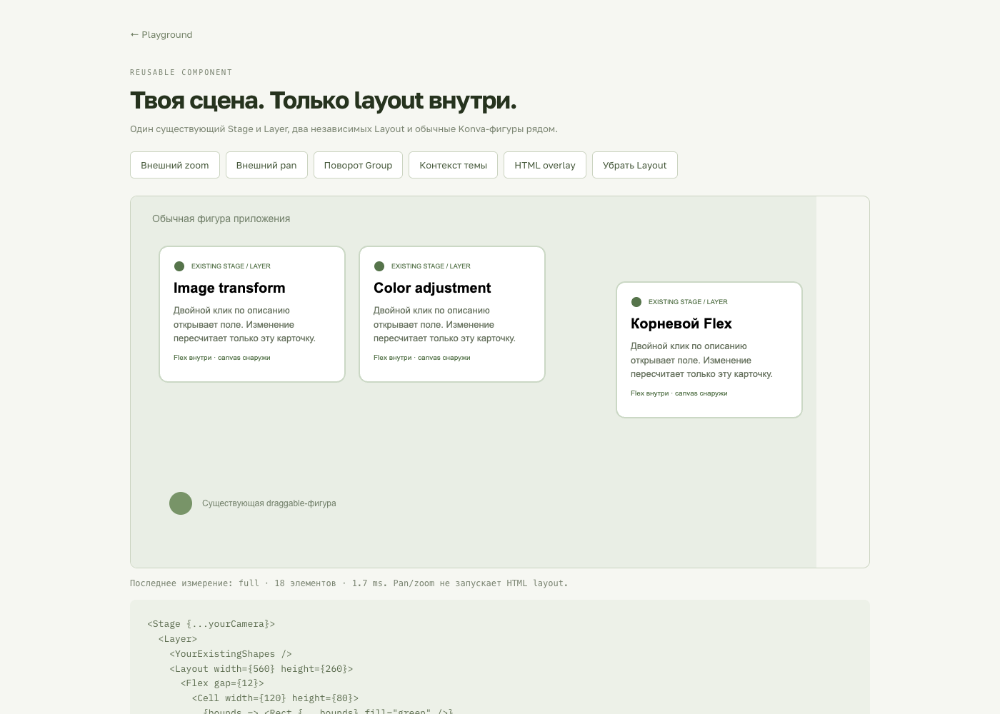
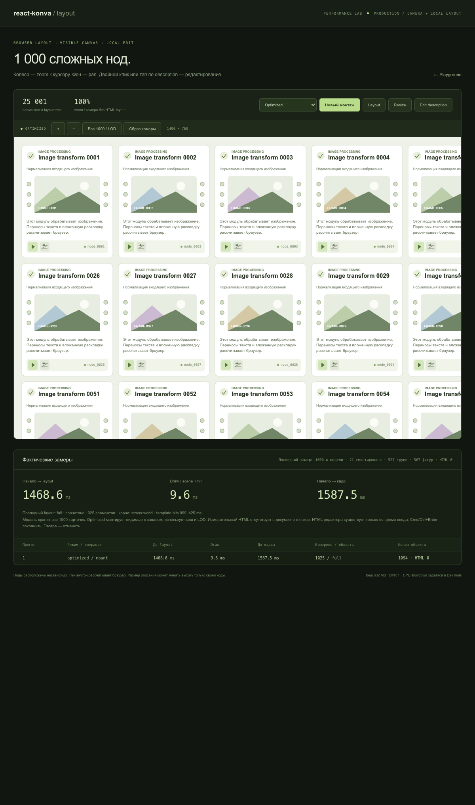
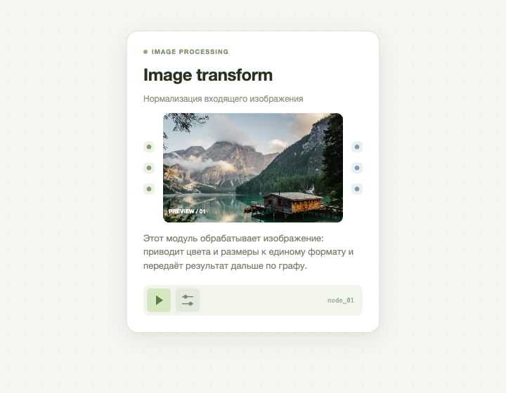
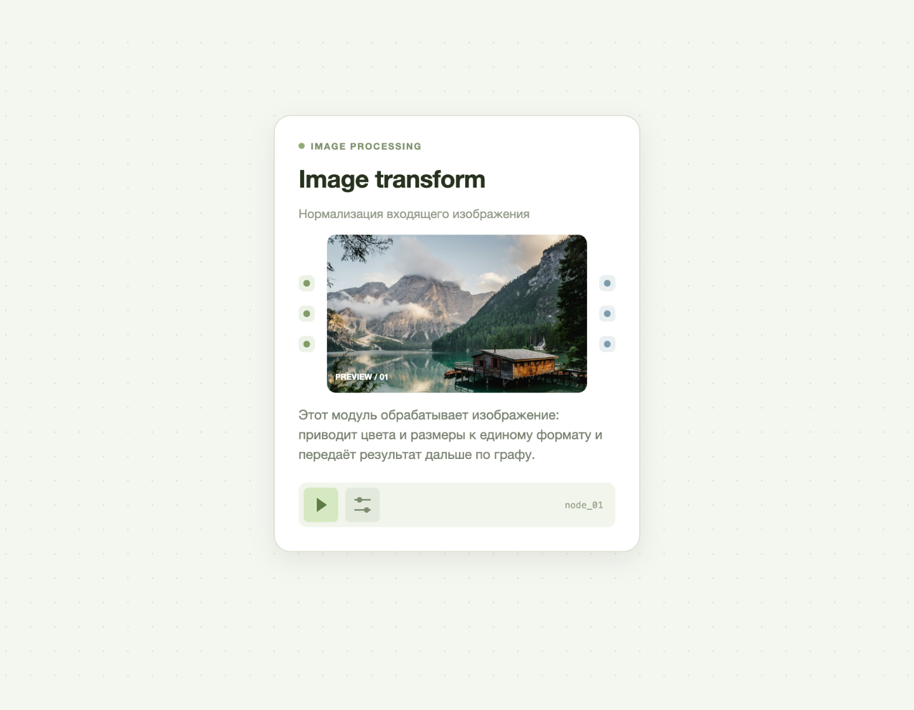

# Встраиваемый компонент

В версии 0.3 основной API — `Flex`, `Cell`, `CellText`. Корневой `Flex` запускает измерение и возвращает Konva-группу внутри существующей сцены. `Layout` позволяет явно задать общий логический контейнер и поместить несколько независимых корней в него.

`src/lib/index.ts` экспортирует только библиотечный API. Создание `Stage/Layer` и управление камерой находятся в `src/examples/`; в пакет они не попадают.

Уточнение текущего API: `CellText` отвечает только за измерение. Редактор из исторических проверок ниже перенесён в `src/examples/text-editor/` и принадлежит приложению; свойства `editable` и `onTextChange` удалены. Обновляйте `text`/стили для автоматического пересчёта или используйте [явный запрос измерения](content-updates.md).

## Ответственность модулей

- `Flex.tsx`, `Layout.tsx` — композиция, публичный ref и подключение к существующей сцене.
- `primitives.tsx` — HTML-представление Flex/Cell/CellText и регистрация.
- `measurementRoot.tsx` — отдельный DOM renderer с мостом React-контекстов.
- `measurement/` — жизненный цикл измерения, чтение геометрии, CSS-политика, ограниченные кеши и стабильная модель.
- `host/` — пассивное наблюдение внешних трансформаций и преобразование координат.
- `rendering/` — группы, пользовательские фигуры, выбор видимых нод, кеши и LOD.
- `src/examples/text-editor/` — временный нативный редактор демо вне библиотеки.

Отдельный DOM renderer нужен потому, что внутри дерева react-konva нельзя напрямую монтировать HTML-элементы. Публичный `useContextBridge` из react-konva сохраняет контексты приложения. Отсоединение DOM от документа сохраняет компонентное состояние и не оставляет скрытые узлы в живом HTML.

`Cell` передаёт локальные координаты внутри своей группы. `CellText` дополнительно передаёт измеренные свойства текста; HTML и Konva используют одинаковые текст/типографику. Это позволяет ячейке менять собственную высоту при изменении описания.

## Проверка

Проверены production-сборка, ESM/TypeScript entry point и независимый обзор кода. Новые файлы тестов не добавлялись.

В браузере проверены:

- один существующий canvas/Layer для двух Layout, включая публичный корневой Flex без явного Layout;
- вложенность Flex → Cell → Flex → Cell/Text, локальные координаты и однократное всплытие событий;
- Stage/Layer/Group pan/zoom, поворот, skew и неодинаковый scale; измерительные метрики при движении камеры не меняются;
- pixel ratio и clip существующего Layer сохраняются;
- мост React-контекстов, состояние пользовательских компонентов и StrictMode mount/unmount;
- локальное изменение описания: измеряется одна нода, соседние группы, модель и bitmap остаются теми же объектами;
- HTML overlay совпадает с Konva после поворота (погрешность BCR менее 0,001 CSS px), при выключении DOM полностью отсоединяется;
- нативное открытие редактора через hit graph, пустой CellText без заданной высоты, сохранение/отмена/IME и очистка;
- CSS whiteSpace/overflowWrap/wordBreak передаются в режим переноса Konva по вычисленному стилю.

Редактор дополнительно прошёл 22 браузерные проверки: affine-координаты, CSS scale, отступы, сохранение draft/selection при обновлении шрифта, IME blur, Enter, Cmd/Ctrl+Enter, Escape, повторное закрытие и удаление target.

## 1000 сложных нод

В новой сцене используются именно Flex/Cell/CellText. Каждая карточка содержит 25 примитивов; всего модель содержит 25 001 элемент. Flex/Cell сохраняют группы, поэтому количество Konva-объектов отличается от старой компактной сцены.

Среда: Apple M5, 10 CPU, 24 GiB RAM, macOS 26.2, Chrome 155, DPR 1. Viewport 1400×760, логический мир 6126×11946. Production-сборка; время заканчивается после полного Layer.draw (scene + hit) и следующего RAF. Это не измерение физического вывода изображения монитором.

| Операция                                      |        Optimized |         Baseline |
| --------------------------------------------- | ---------------: | ---------------: |
| Первый кадр, медиана 3 запусков               |        1902,1 ms |        3311,4 ms |
| Диапазон первого кадра                        | 1770,3–2005,1 ms | 2879,8–3387,7 ms |
| Layer.draw, медиана                           |          11,4 ms |         145,4 ms |
| Измерено элементов                            |             1025 |           25 001 |
| Повторно использовано шаблонов                |              999 |                0 |
| Смонтировано групп / фигур                    |        527 / 567 |  25 002 / 27 000 |
| HTML-узлов layout в документе после измерения |                0 |                0 |
| Первый кадр при CPU ×4, один запуск           |      10 197,1 ms |      21 628,6 ms |

Локальное редактирование description: 25 прочитанных элементов, 4,2 ms на измерение, 49,9 ms до кадра. В обзорном LOD остаются 1000 metadata-групп, общие корни и одна пакетная Shape; растровые кеши освобождаются. Внешнее перемещение камеры и обзорный LOD не выполняют HTML-измерений.

Первый монтаж всё ещё строит HTML всех 1000 карточек. Это основная оставшаяся стоимость на слабом CPU; culling сокращает canvas-дерево после измерения. Исторические результаты старого API нельзя напрямую считать регрессией или улучшением нового: обязательная структура групп и fixture изменились.

Полные результаты: [embedded-results.json](embedded-results.json).

## Оформленная нода по структуре CodeSandbox

`ReferenceNode` сохраняет исходную иерархию: node → main → content (label, title, subtitle, figure, description), затем actionPanel. Figure содержит колонки с тремя портами по краям и превью между ними. Все контейнеры создаются через Flex/Cell/CellText; нативные Konva-фигуры возвращаются из функций ячеек.

В текущем дизайне нода — светлая карточка с рамкой, скруглением и мягкой тенью. Заголовки видны постоянно; описание имеет естественную высоту. Фотография в превью вписывается с центральной обрезкой, входные порты зелёные, выходные голубые. Нижняя панель содержит компактные кнопки запуска и настроек. Режим серых/чёрных блоков удалён из основного примера.

Фото загружается приложением из локального public/node-preview.jpg и передаётся в компонент через previewImage. Ассет работает и при размещении сайта в подпапке. Автор и лицензия указаны в public/ATTRIBUTION.md.

Проверены production-сборка и TypeScript, отображение фотографии внутри кешированной ноды, обработчики обеих кнопок и портов, изменение ширины, внешние zoom/pan, редактирование в масштабе 0.8 и изоляция колеса в textarea. Изменение описания: scope=local, 35 измеренных элементов, 2.4 ms в контрольном прогоне; объекты заголовка и изображения сохраняются. После сохранения HTML и textarea отсутствуют в документе. Дополнительные файлы тестов не создавались.

[Нативный редактор описания](screenshots/designed-node-editor.png).

## Чёткость на Retina и при zoom

Причина размытия: целая нода, включая текст и фото, кешировалась при pixelRatio=1 независимо от разрешения Layer и масштаба. На проверенном Retina-экране Layer имеет 1920×1280 физических пикселей при CSS-размере 960×640 (DPR 2); кеш 1× растягивался. При zoom 80% текст проходил через дополнительное увеличение растровой копии.

Теперь auto-плотность берётся из максимального растяжения полной матрицы layout → Stage и pixelRatio существующего Layer. Плотность округляется вверх до степени 2; уменьшение имеет запас 10% для предотвращения колебаний кеша у границы. Числовой cachePixelRatio сохраняет прежний фиксированный режим. Canvas и камера остаются собственностью приложения.

Проверено в браузере при DPR 2:

- zoom 1 и 0.8: кеш 2×; zoom 2: кеш 4×;
- pan сохраняет тот же bitmap; увеличение плотности сохраняет объект Konva-группы;
- zoom 8: слишком большой кеш отклоняется до выделения памяти, нода рисуется напрямую;
- изменение Layer pixelRatio владельцем до 3 обновляет кеш до 4×, возврат к 2 — до 2×;
- все эти операции сохраняют объект метрик измерения, HTML не добавляется;
- активный textarea сохраняется при смене zoom/плотности, редактируемая нода временно не кешируется;
- сохранение description даёт локальное измерение 35 элементов; неизменённые Text и LayoutNode сохраняются.

Исторический стресс-прогон `?stress=1&retina=1` использовал прежние карточки шириной 230 px: 1000 нод, canvas DPR 2, 21 корень в viewport, 13 растровых кешей, 14 126 320 фактически выделенных байт. Первый кадр 1439ms, измерено 1025 элементов с 999 template hits. Pan не выполняет layout; локальное редактирование читает 25 элементов и занимает 50.7ms до кадра. В минимальном LOD остаётся одна Shape, растровые кеши освобождены. Лимит 32MiB контролируется по резерву scene/hit/filter, поэтому фактическое выделение ниже бюджета. Сейчас `?stress=1` использует оформленный `ReferenceNode` шириной 360 px и DPR устройства; актуальные результаты находятся в [отчёте о 1000 новых нодах](designed-stress.md).

Вариант того же исторического benchmark с DPR 1 и кешем 1× дал 21 кеш, 5 704 860 байт и 1025 прочитанных элементов. Нынешние Playground и стресс-сцена наследуют родную плотность устройства.

[До исправления](screenshots/retina-before.png) · [После исправления](screenshots/retina-after.png). Оба снимка сделаны при DPR 2 и zoom 80%.

